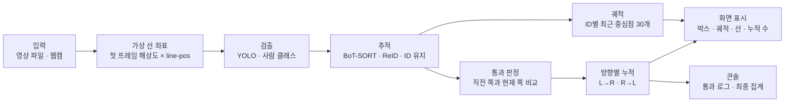

# EntranceCounter: 객체 추적 기반 출입 인원 카운터

영상 속 가상 선 하나를 기준으로 선을 넘는 사람을 방향별로 집계하는 출입 인원 카운터.
YOLO 검출과 BoT-SORT 추적으로 프레임 간 사람 ID를 유지하고, ID별 중심점 이동 궤적 표시.


*노란 세로선이 가상 선. 사람마다 초록 박스, `ID <번호>`, 파란색 이동 궤적 표시.*

---

## 개요

| 항목 | 내용 |
|---|---|
| 목적 | 가상 선을 넘는 사람을 방향별로 집계 |
| 입력 | 영상 파일 또는 웹캠, 기본값은 저장소의 보행자 영상 `sample.mp4` |
| 검출·추적 | Ultralytics YOLO `yolov8n.pt`, BoT-SORT와 ReID로 프레임 간 같은 사람 ID 유지 |
| 출력 | 화면에 박스·ID·이동 궤적·방향별 누적 통과 수, 콘솔에 통과 로그와 최종 집계 |
| 검증 | `sample.mp4` 반복 실행으로 가려짐·재등장 상황 관찰, 추적기 설정 조정 기록 |

*YOLO: Ultralytics 객체 검출 모델. BoT-SORT: 칼만 필터 위치 예측과 IoU 매칭에 ReID 외형 매칭, 카메라 움직임 보정을 더한 다중 객체 추적기.*

---

## 전체 구조



| 단계 | 내용 | 위치 |
|---|---|---|
| 입력 | `--source` 영상 경로 또는 웹캠 번호, 숫자 입력은 웹캠 번호로 해석 | `entrance_counter.py` `main()` |
| 선 좌표 계산 | 첫 프레임 해상도 확인 후 세로선은 폭 × `--line-pos`, 가로선은 높이 × `--line-pos` | `main()` |
| 검출·추적 | `model.track(..., persist=True, stream=True)`, `--classes` 클래스만 추적, 기본은 사람 | `main()`, `tracker_cfg/botsort_custom.yaml` |
| 궤적 | ID별 최근 중심점 30개 저장 | `trails` |
| 통과 판정 | ID별 직전 프레임 위치와 현재 위치를 선 기준으로 비교, 방향별 누적 | `side_of()`, `prev_side` |
| 렌더링 | 박스·선·궤적은 OpenCV, 텍스트는 Pretendard 폰트로 프레임당 PIL 변환 1회 | `put_texts_pretendard()`, `fonts/` |
| 출력 | 화면 표시, 통과 때마다 콘솔 로그, 종료 시 최종 집계 | `main()` |

---

## 구현

### 방향별 통과 집계

- 가상 선: `--orientation vertical`이면 세로선, `horizontal`이면 가로선. 위치는 첫 프레임 폭 또는 높이 × `--line-pos`
- 위치 판정: 박스 중심점 좌표가 선 좌표보다 작으면 `L`, 크거나 같으면 `R`. 가로선에서는 `L`이 선 위쪽, `R`이 선 아래쪽
- 통과 조건: 같은 ID의 직전 프레임 쪽과 현재 쪽이 다를 때 방향별 1회 집계. 처음 나타난 ID는 위치만 기록
- 같은 ID가 선을 다시 넘으면 그때마다 다시 집계
- 통과 순간 콘솔에 `[통과] ID <번호>: L -> R` 형식 로그와 방향별 누적 수 출력
- 종료: `q` 입력 또는 영상 끝. 방향별 통과 인원과 전체 감지 ID 수 출력, 전체 감지 ID 수는 한 번이라도 추적된 ID 개수

```python
cur_side = side_of(cx, cy)
prev = prev_side.get(track_id)
if prev is not None and prev != cur_side:
    if prev == "L" and cur_side == "R":
        count_l_to_r += 1
    elif prev == "R" and cur_side == "L":
        count_r_to_l += 1
prev_side[track_id] = cur_side
```

### ID 추적: `tracker_cfg/botsort_custom.yaml`

- `model.track()`에 `persist=True`를 넘겨 프레임이 바뀌어도 이전 트랙 ID를 이어서 사용, `stream=True`로 프레임 단위 결과 수신
- `--classes` 기본값 0으로 COCO 사람 클래스만 추적, 차량은 추적 대상 제외
- 추적기 설정은 `--tracker` 기본값인 `tracker_cfg/botsort_custom.yaml`. 기본 `botsort.yaml` 복사본에서 아래 항목 조정

| 항목 | 기본값 → 설정값 | 목적 |
|---|---|---|
| `track_buffer` | 30 → 60 | 차량 등 큰 물체에 1초 넘게 가려지는 경우 대응, 약 2초 분량 트랙 유지 |
| `match_thresh` | 0.8 → 0.7 | 1-IoU 기반 매칭 비용 상한, 낮출수록 겹침이 큰 후보끼리만 매칭 |
| `new_track_thresh` | 0.25 → 0.3 | 오검출로 인한 불필요한 새 ID 생성 감소 |
| `proximity_thresh` | 0.5 → 0.3 | 하반신 가려짐으로 박스가 작아진 경우에도 ReID 외형 비교 실행 |
| `appearance_thresh` | 0.8 → 0.1 | 낮출수록 외형 재매칭 증가 |
| `with_reid` | False → True | ReID 외형 매칭 사용 |
| `gmc_method` | sparseOptFlow 유지 | 카메라 움직임 보정 |

조정 과정과 관찰 결과: [문제 해결](#문제-해결)

### 화면 표시와 텍스트 렌더링: `put_texts_pretendard()`

| 요소 | 표시 |
|---|---|
| 가상 선 | 노란색 선 |
| 사람 | 초록 박스와 `ID <번호>` |
| 이동 궤적 | ID별 최근 30프레임 중심점을 이은 파란색 선 |
| 누적 수 | 왼쪽 위 `L→R`, `R→L` 누적 통과 수와 누적 추적 ID 수, 흰 글씨·검정 테두리 |

- `cv2.putText`는 OpenCV 내장 Hershey 폰트 전용이라 Pretendard 사용 불가. PIL로 텍스트를 그린 뒤 OpenCV BGR 이미지로 되돌리는 방식
- 박스·선·궤적은 OpenCV로 그리고, 텍스트만 프레임별 목록에 모아 `put_texts_pretendard()` 한 번으로 그리기. 사람 수와 무관하게 프레임당 BGR↔RGB 변환 1회
- 폰트 객체는 굵기·크기별로 `_font_cache`에 저장해 재사용
- PIL 내장 외곽선 `stroke_width`로 검은 테두리, 배경색과 무관한 가독성 확보
- 표시 축소: 원본 폭이 `--max-width` 기본 960px보다 크면 비율 유지 축소. 좌표 계산은 원본 해상도 기준이라 탐지 품질 영향 없음
- 텍스트는 축소 뒤에 그리므로 ID 표시 좌표에 축소 비율 `display_scale` 적용
- 폰트: `fonts/Pretendard-Regular.ttf`, `fonts/Pretendard-Bold.ttf` 포함, SIL OFL 라이선스, 설치 불필요

### 실행 결과: `sample.mp4`

`sample.mp4` 393프레임을 기본 설정으로 끝까지 실행하며 40프레임마다 저장한 화면 중 일부. 왼쪽 위 숫자는 방향별 누적 통과 수.

| 120프레임 · 멀리 걷는 사람들에게 ID 부여 | 200프레임 · 차량은 제외하고 사람만 추적 |
|---|---|
|  |  |

| 240프레임 · 누적 R→L 6명 | 320프레임 · 가까이 지나가는 사람과 궤적 |
|---|---|
|  |  |

같은 실행의 전체 콘솔 출력. 통과 이벤트마다 ID와 방향, 끝에 최종 집계 L→R 7명, R→L 11명, 전체 감지 ID 74개.


---

## 문제 해결

### 차량에 하반신이 가려질 때 새 ID 발생

`sample.mp4` 반복 실행 관찰 기록.

문제: 차가 사람 앞을 지나가며 하반신만 가려지는 장면에서 새 ID 발생. 사람이 완전히 사라진 경우가 아니라 검출이 이어지는 중의 ID 변경.

원인: 사람이 보이지 않아서가 아니라 박스 형태 급변 → IoU 매칭 실패 → ReID 필터 미통과의 연쇄.

1. 다리가 가려지면 박스가 위쪽 절반만 남은 짧고 넓은 모양으로 순간 변경
2. 칼만 필터는 직전까지의 전신 박스 모양을 기준으로 다음 위치를 예측하므로 짧아진 박스와의 IoU 급감. 1-IoU 기반 매칭 비용이 기존 `match_thresh` 0.8을 넘어 매칭 실패
3. `proximity_thresh`는 IoU가 일정 수준 이상인 후보만 외형 비교로 넘기는 1차 필터. 박스가 이만큼 작아지면 이 필터를 통과하지 못해 ReID를 켜도 외형 비교 미실행

해결: 추적기 설정 항목별 조정과 관찰.

| 조정 | 값 변화 | 관찰 결과 |
|---|---|---|
| `track_buffer` | 30 기본 → 90 → 45 → 60 | 90에서 가려짐 대응 효과가 가장 컸으나 사람 많은 장면에서 유지 중인 트랙이 늘어 속도 저하. 45~60 범위에서 속도와 가려짐 대응 절충 |
| `match_thresh` | 0.8 → 0.7 | 1-IoU 기반 매칭 비용 허용 상한 하향, 겹침이 더 큰 후보끼리만 매칭 |
| `proximity_thresh` | 0.5 → 0.3 | 박스가 작아진 상황에서도 ReID 외형 비교 실행, 핵심 원인 대응 |
| `appearance_thresh` | 0.8 기본 → 0.6 → 0.1 | 낮출수록 재매칭이 늘어 ID 스위치 감소. 0.1까지 낮추면 다른 사람끼리 ID가 잘못 붙을 위험 증가, 옷차림이 비슷한 보행자가 많은 영상이라 이 트레이드오프가 뚜렷 |
| `with_reid` | False → True | 켜기만 해서는 효과 없음, `proximity_thresh`를 함께 낮춘 뒤 효과 확인 |
| `gmc_method` | sparseOptFlow 기본 유지 | `sample.mp4`는 삼각대 고정 카메라 영상이라 카메라 움직임 보정 필요성 낮음. 흔들리거나 패닝하는 영상에서는 sparseOptFlow 유지가 유리 |

결과:

- 최종 설정 `tracker_cfg/botsort_custom.yaml`: `track_buffer=60`, `match_thresh=0.7`, `proximity_thresh=0.3`, `appearance_thresh=0.1`, `with_reid=True`, `gmc_method=sparseOptFlow`. 가려짐 대응 우선 설정
- 작고 멀리서 찍힌 보행자가 많은 이 영상에서는 시도한 파라미터 조합으로도 ID 스위치 잔존. 박스가 작을수록 IoU·외형 정보 모두 신뢰도 하락
- 파라미터 조정은 가려짐 대응과 속도, 재매칭 허용 범위와 오매칭 위험이라는 두 트레이드오프의 절충

### 다인원 장면의 텍스트 렌더링 속도 저하

문제: 사람이 여러 명인 장면에서 속도 크게 저하.

원인: Pretendard 사용을 위해 `cv2.putText` 대신 PIL로 텍스트를 그리면서, 박스마다 프레임 전체를 PIL 이미지로 변환했다가 되돌리는 과정 반복.

해결: 프레임당 그릴 텍스트를 목록에 모은 뒤 `put_texts_pretendard()`에서 한 번에 그리도록 구조 변경.

결과: PIL 변환이 사람 수와 무관하게 프레임당 1회로 고정, 다인원 장면의 속도 저하 해결.

---

## 한계와 개선 방향

| 설계 선택 | 한계 | 개선 방향 |
|---|---|---|
| 가려짐 대응 우선 추적기 설정 | 작고 먼 보행자의 ID 스위치 잔존, `appearance_thresh` 0.1에서 다른 사람끼리 ID가 붙을 위험 | 카메라가 흔들리거나 옷차림이 다양한 군중 영상에서는 설정 재조정 |
| YOLO 기본 입력 크기 640 | 작고 먼 사람의 검출 불안정 | `imgsz`를 960 등 640보다 높게 설정 |
| BoT-SORT 단일 추적기 | 다른 추적기와의 ID 스위치 비교 기록 없음 | ByteTrack `tracker="bytetrack.yaml"`으로 바꿔 ID 스위치 횟수 비교 |
| 중심점이 선을 넘을 때마다 집계 | 선 근처 검출 잔떨림으로 중복 집계 가능 | 선 양쪽에 여유 구간을 두는 히스테리시스 추가 |
| 가상 선 1개 | 구역별 진입·이탈 구분 불가 | 가상 선 2개 이상으로 구역별 진입·이탈 계산 |
| 방향별 카운터 1쌍 | `--classes`로 여러 클래스를 지정해도 클래스 구분 없이 합산 | `--classes 0 2`처럼 사람과 차량을 함께 지정해 클래스별 집계 |
| 통과 결과 콘솔 출력 | 실행 종료 후 기록 미보존 | 통과 로그를 CSV로 누적해 시간대별 리포트 생성 |

---

## 실행 방법

```bash
conda activate vision_new
pip install ultralytics opencv-contrib-python pillow numpy
```

```bash
# sample.mp4 보행자 영상으로 실행, 기본값
python entrance_counter.py

# 웹캠으로 실행
python entrance_counter.py --source 0

# 가상 선 위치·방향 조정, 0.0~1.0 비율
python entrance_counter.py --line-pos 0.4 --orientation vertical

# 창 크기, 기본 960px 축소 표시. 0이면 원본 해상도, 화면 표시만 바뀌고 탐지 품질에는 영향 없음
python entrance_counter.py --max-width 0
```

| 옵션 | 기본값 | 내용 |
|---|---|---|
| `--source` | `sample.mp4` | 영상 파일 경로 또는 웹캠 번호 |
| `--model` | `yolov8n.pt` | YOLO 검출 모델, 최초 실행 시 자동 다운로드 |
| `--line-pos` | 0.5 | 가상 선 위치, 화면 폭·높이 기준 0.0~1.0 비율 |
| `--orientation` | `vertical` | `vertical`은 세로선 좌우 통과 판정, `horizontal`은 가로선 상하 통과 판정 |
| `--classes` | 0 | 추적 클래스 id, COCO 기준 0은 사람, 여러 개 지정 가능 |
| `--max-width` | 960 | 표시 창 최대 가로 폭 px, 원본이 더 크면 비율 유지 축소, 0이면 원본 크기 |
| `--tracker` | `tracker_cfg/botsort_custom.yaml` | 추적기 설정 파일 |

실행 중 `q` 입력으로 종료. YOLO 가중치 `*.pt`는 저장소에서 제외, 최초 실행 시 자동 다운로드.

## 폴더 구성

```
entrance_counter.py   검출·추적·통과 집계·화면 표시
tracker_cfg/          BoT-SORT 설정 botsort_custom.yaml
fonts/                Pretendard Regular·Bold, SIL OFL
sample.mp4            기본 입력 보행자 영상
docs/                 README 그림
```
