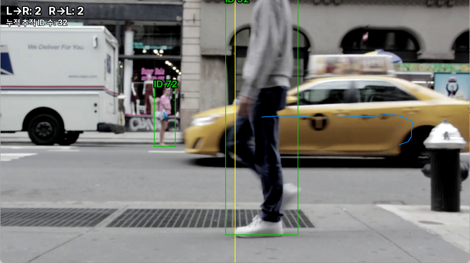
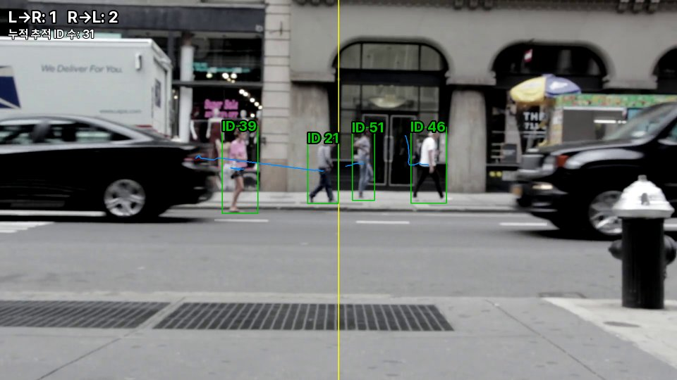
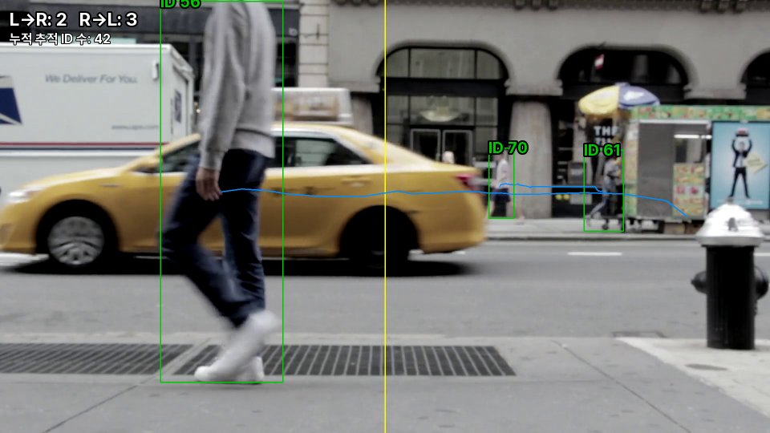
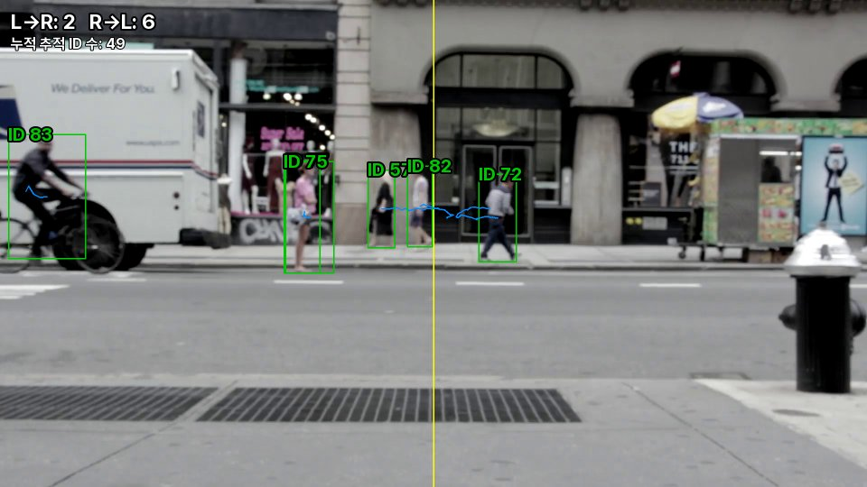
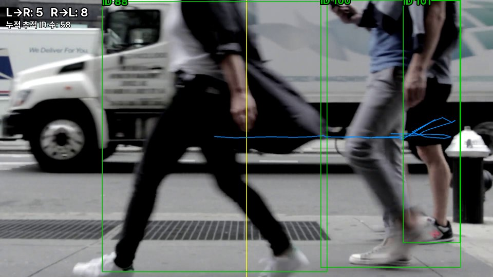
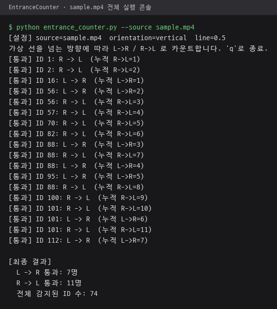

# EntranceCounter — 객체 추적 기반 출입 인원 카운터

가상 선 하나를 기준으로, 선을 넘는 사람을 방향별로 센다.
소스: `entrance_counter.py`. Ultralytics YOLO + BoT-SORT(`model.track(..., persist=True)`)로
프레임 간 사람 ID를 유지하고, ID별 중심점 궤적을 그린다.

## 설치

```bash
conda activate vision_new
pip install ultralytics opencv-contrib-python pillow numpy
```

폰트 `fonts/Pretendard-Regular.ttf`, `fonts/Pretendard-Bold.ttf` 포함 (SIL OFL 라이선스, 설치 불필요).
화면 텍스트는 OpenCV 기본 폰트 대신 Pretendard로 렌더링한다 (PIL 사용).

## 데모



노란 세로선이 가상 선이고, 사람마다 초록 박스, `ID <번호>`, 파란색 이동 궤적을 표시한다.
종료(`q` 또는 영상 끝) 시 콘솔에 방향별 통과 인원과 전체 감지 ID 수를 출력한다 (아래 전체 콘솔 출력 참고).

### 프레임별 실행 장면

저장소의 `sample.mp4` 393프레임을 기본 설정으로 끝까지 실행하며 40프레임마다 저장한 화면 중 일부. 왼쪽 위 숫자가 방향별 누적 통과 수.

| 120프레임 · 멀리 걷는 사람들에게 ID 부여 | 200프레임 · 차량은 제외하고 사람만 추적 |
|---|---|
|  |  |

| 240프레임 · 누적 R→L 6명 | 320프레임 · 가까이 지나가는 사람과 궤적 |
|---|---|
|  |  |

같은 실행의 전체 콘솔 출력. 통과 이벤트마다 ID와 방향, 끝에 최종 집계.



## 실행

```bash
# sample.mp4 보행자 영상으로 실행 - 기본값
python entrance_counter.py

# 웹캠으로 실행
python entrance_counter.py --source 0

# 가상 선 위치/방향 조정 (0.0~1.0 비율)
python entrance_counter.py --line-pos 0.4 --orientation vertical

# 창 크기 (기본 960px 축소 표시. 0이면 원본 해상도 - 화면 표시만 바뀌고 탐지 품질에는 영향 없음)
python entrance_counter.py --max-width 0
```

화면 표시:
- 사람마다 박스와 `ID <번호>`
- 최근 30프레임 이동 궤적(파란색 선)
- 가상 선(노란색). 선을 넘으면 콘솔 로그 출력, 화면 상단 카운트(`L→R`, `R→L`) 갱신 (흰 글씨, 검정 테두리, Pretendard)

`q`로 종료하면 콘솔에 최종 통과 인원과 전체 감지 ID 수를 출력한다.

## 구현 범위

| 기능 | 구현 |
|---|---|
| 같은 사람 ID 유지 추적 | BoT-SORT + ReID (`tracker_cfg/botsort_custom.yaml`) |
| 이동 궤적 표시 | ID별 중심점 30프레임 이동 궤적 시각화 |
| 가려짐·재등장 테스트 | 아래 "가려짐 테스트 기록" |
| 영상·웹캠 데모 | `entrance_counter.py` |

---

## 가려짐 테스트 기록

`sample.mp4`로 여러 번 실행하며 관찰한 내용.

### 원인 분석: ID가 바뀌는 이유

**차가 사람 앞을 지나가며 하반신만 가려지는 상황에서 새 ID 발생.**
사람이 완전히 안 보이는 경우가 아니라, 다리만 가려진 채 **검출은 계속되는데** ID가 바뀌는 경우였다.
원인:

1. 다리가 가려지면 박스가 위쪽 절반만 남은 짧고 넓은 모양으로 순간 변경
2. 칼만 필터는 직전까지의 전신 박스 모양을 기준으로 다음 위치를 예측하므로, 짧아진 박스와 **IoU 급감** → 매칭 비용(1-IoU 기반)이 기존 `match_thresh(0.8)`를 넘어 매칭 실패
3. **ReID(외형 매칭)를 켜도 효과 없음** — `proximity_thresh`는 IoU가 일정 수준 이상인 후보에 한해 외형 비교를 시도하는 1차 필터라서, 박스가 이렇게 작아지면 이 필터를 통과하지 못해 **외형 비교가 실행되지 않음**. ReID를 켠 효과가 사라지는 조건이었다.

즉 원인은 "사람이 안 보여서"가 아니라 **박스 형태 급변 → IoU 실패 → ReID 필터 미통과**였다.

### 조건별 관찰 결과 (실험 기록)

| 조정 | 값 변화 | 관찰된 효과 |
|---|---|---|
| `track_buffer` | 30(기본) → 90 → 45 → 60 | 90은 가려짐 대응 효과가 가장 컸지만, 사람 많은 장면에서 유지 중인 트랙이 늘어 **처리 속도 저하**. 45~60 범위에서 속도·가려짐 대응 절충 |
| `match_thresh` | 0.8 → 0.7 | 매칭 비용(1-IoU 기반) 허용 상한을 낮춤 → 겹침이 더 큰 후보끼리만 매칭 |
| `proximity_thresh` | 0.5 → 0.3 | 박스가 작아진 상황에서도 ReID(외형 비교) **실행** (핵심 원인 대응) |
| `appearance_thresh` | 0.8(기본) → 0.6 → 0.1 | 낮출수록 재매칭이 늘어 ID 스위치는 줄지만, **0.1까지 낮추면 다른 사람끼리 ID가 잘못 붙을 위험** 증가. 옷차림이 비슷한 보행자가 많은 영상이라 이 트레이드오프가 뚜렷하게 나타남 |
| `with_reid` | False → True | 켜는 것만으로는 효과 없음, `proximity_thresh`를 함께 낮춘 뒤 효과 확인 (위 원인 분석 참고) |
| `gmc_method` | sparseOptFlow(기본) 유지 | `sample.mp4`는 고정 카메라(삼각대) 영상이라 카메라 움직임 보정이 거의 필요 없음 (흔들리거나 패닝하는 영상이면 sparseOptFlow 유지가 유리) |

### 결론

- **작고 멀리서 찍힌 보행자**가 많은 이 영상은 시도한 파라미터 조합으로도 ID 스위치를 완전히 없애지는 못했다. 박스가 작을수록 IoU·외형 정보 둘 다 신뢰도가 떨어지기 때문.
- 파라미터 튜닝은 **"가려짐 대응 ↔ 속도" / "재매칭 허용 범위 ↔ 오매칭 위험"** 두 가지 트레이드오프의 절충 문제였다.
- 최종 설정(`tracker_cfg/botsort_custom.yaml`): `track_buffer=60`, `match_thresh=0.7`, `proximity_thresh=0.3`, `appearance_thresh=0.1`, `with_reid=True`, `gmc_method=sparseOptFlow` — 가려짐 대응을 우선한 설정이며, 다른 영상(카메라가 흔들리거나 옷차림이 다양한 군중)에서는 재조정이 필요할 수 있음.

## 성능 최적화: 텍스트 렌더링

Pretendard 폰트를 쓰기 위해 `cv2.putText` 대신 PIL로 텍스트를 그린다. 처음에는 **박스마다 프레임 전체를 PIL로 변환했다가 되돌리는 과정을 반복**해서, 사람이 여러 명이면 처리 속도가 크게 떨어졌다.
→ 프레임당 그릴 텍스트를 리스트에 모은 뒤 **PIL 변환을 프레임당 1번만** 하도록 구조를 바꿔 해결 (`put_texts_pretendard()`).

## 확장 아이디어

- `--classes 0 2`처럼 사람(0)과 차량(2)을 함께 카운트
- 가상 선을 2개 이상 두어 구역별 진입/이탈 계산
- 통과 로그를 CSV로 쌓아 시간대별 리포트 생성
- ByteTrack(`tracker="bytetrack.yaml"`)으로 바꿔 ID 스위치 횟수 비교
- `imgsz`를 640보다 높여(예: 960) 작고 먼 사람의 검출 안정성 향상 (아직 미구현)
- 선 근처 검출 잔떨림으로 인한 중복 카운트 방지용 히스테리시스(여유 구간) 추가 (아직 미구현)
